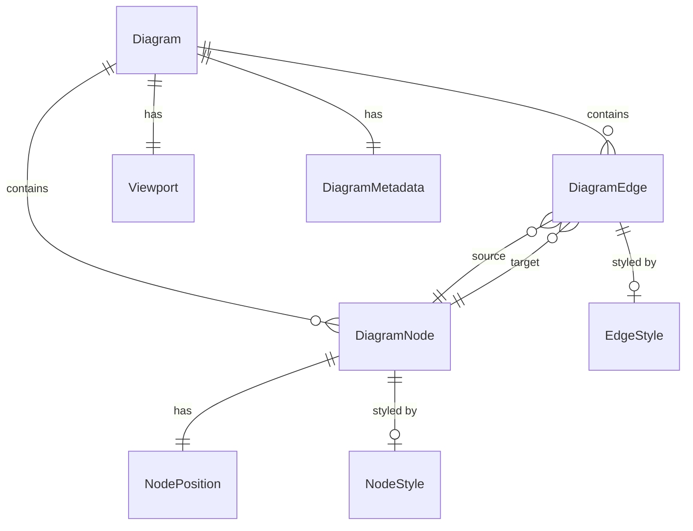

# Diagram Data Model

This document defines the conceptual data model for Pichara Diagram Studio. All types are defined in `src/PicharaStudio/types/` and must remain JSON-serializable.

## Entity Relationship



## Core Types

### Diagram

The root container for all diagram data. One `Diagram` represents one complete diagram file.

```typescript
interface Diagram {
  id: string;             // Unique identifier (UUID v4)
  name: string;           // User-facing diagram title
  description: string;    // Optional description
  diagramType: DiagramType;
  nodes: DiagramNode[];
  edges: DiagramEdge[];
  viewport: Viewport;
  metadata: DiagramMetadata;
}
```

**`DiagramType`** — Discriminator for the kind of diagram:

```typescript
type DiagramType =
  | "flowchart"
  | "architecture"
  | "uml-class"
  | "uml-sequence"
  | "erd"
  | "infrastructure"
  | "system-design"
  | "general";
```

The diagram type determines which node and edge types are available in the sidebar shape library.

### DiagramNode

A visual element on the canvas. Wraps React Flow's `Node` model with application-specific data.

```typescript
interface DiagramNode<T extends BaseNodeData = BaseNodeData> {
  id: string;             // Unique node identifier
  type: string;           // Registered React Flow node type key
  position: NodePosition; // Canvas coordinates (top-left corner)
  data: T;                // Type-specific payload (label, style, etc.)
  width?: number;         // Measured or explicit width in pixels
  height?: number;        // Measured or explicit height in pixels
  selected?: boolean;     // Selection state (transient, not persisted)
  dragging?: boolean;     // Drag state (transient, not persisted)
  parentId?: string;      // Parent node ID for grouping
}
```

### NodePosition

Canvas coordinates for the top-left corner of a node.

```typescript
interface NodePosition {
  x: number;  // Horizontal position in canvas units
  y: number;  // Vertical position in canvas units
}
```

### BaseNodeData

Minimum data payload every node carries. Custom node types extend this interface.

```typescript
type BaseNodeData = {
  label: string;          // Primary display text
  description?: string;   // Secondary descriptive text
  style?: NodeStyle;      // Visual customization
};
```

> Defined as a `type` (not an `interface`) so it stays assignable to React
> Flow's `Record<string, unknown>` data constraint — TypeScript interfaces do
> not get an implicit index signature.

### NodeStyle

Visual properties applied to a node's rendered output.

```typescript
interface NodeStyle {
  backgroundColor?: string;  // Fill color (CSS color value)
  borderColor?: string;      // Border/stroke color
  borderWidth?: number;      // Border width in pixels
  borderRadius?: number;     // Corner radius in pixels
  textColor?: string;        // Text fill color
  fontSize?: number;         // Text size in pixels
  fontWeight?: string;       // CSS font-weight value
  opacity?: number;          // 0.0 – 1.0
}
```

### DiagramEdge

A connection between two nodes. Wraps React Flow's `Edge` model.

```typescript
interface DiagramEdge<T extends BaseEdgeData = BaseEdgeData> {
  id: string;               // Unique edge identifier
  type: string;             // Registered React Flow edge type key
  source: string;           // Source node ID
  target: string;           // Target node ID
  sourceHandle?: string;    // Specific handle on source node
  targetHandle?: string;    // Specific handle on target node
  data?: T;                 // Type-specific payload (label, style, etc.)
  selected?: boolean;       // Selection state (transient)
}
```

### BaseEdgeData

Minimum data payload for edges. Custom edge types extend this.

```typescript
type BaseEdgeData = {
  label?: string;         // Text displayed along the edge
  style?: EdgeStyle;      // Visual customization
};
```

> Defined as a `type` (not an `interface`) for the same React Flow
> assignability reason as `BaseNodeData`.

### EdgeStyle

Visual properties applied to edge rendering.

```typescript
interface EdgeStyle {
  strokeColor?: string;      // Line color
  strokeWidth?: number;      // Line width in pixels
  strokeDasharray?: string;  // SVG dash pattern (e.g. "5,5" for dashed)
  animated?: boolean;        // Animated flow indicator
  opacity?: number;          // 0.0 – 1.0
}
```

### Viewport

The camera position and zoom level of the canvas.

```typescript
interface Viewport {
  x: number;    // Horizontal pan offset
  y: number;    // Vertical pan offset
  zoom: number; // Zoom level (1.0 = 100%)
}
```

### DiagramMetadata

Information about the diagram itself — not its visual content.

```typescript
interface DiagramMetadata {
  createdAt: string;    // ISO 8601 timestamp
  updatedAt: string;    // ISO 8601 timestamp
  version: string;      // Schema version for future migrations (e.g. "1.0.0")
  author?: string;      // Optional author name
  tags?: string[];      // Optional classification tags
}
```

## Serialization Format

When exported to JSON, a diagram produces a single file with the following structure:

```json
{
  "id": "550e8400-e29b-41d4-a716-446655440000",
  "name": "System Architecture",
  "description": "High-level architecture of the payment service",
  "diagramType": "architecture",
  "nodes": [
    {
      "id": "node-1",
      "type": "architecture-service",
      "position": { "x": 100, "y": 200 },
      "data": {
        "label": "Payment API",
        "description": "Handles payment processing",
        "style": {
          "backgroundColor": "#e3f2fd",
          "borderColor": "#1976d2"
        }
      },
      "width": 200,
      "height": 80
    }
  ],
  "edges": [
    {
      "id": "edge-1",
      "type": "default",
      "source": "node-1",
      "target": "node-2",
      "data": {
        "label": "REST API"
      }
    }
  ],
  "viewport": { "x": 0, "y": 0, "zoom": 1 },
  "metadata": {
    "createdAt": "2026-11-18T19:00:00.000Z",
    "updatedAt": "2026-11-18T19:30:00.000Z",
    "version": "1.0.0",
    "author": "Rodrigo Pichara Gomes",
    "tags": ["architecture", "payment"]
  }
}
```

## Extensibility

### Adding a New Node Type

1. Define a new data interface extending `BaseNodeData` in `types/node.ts`.
2. Create a React component in `nodes/<category>/`.
3. Register the type key in the React Flow `nodeTypes` map.
4. Add the shape to the sidebar library under the appropriate category.

### Adding a New Edge Type

1. Define a new data interface extending `BaseEdgeData` in `types/edge.ts` (if custom data is needed).
2. Create a React component in `edges/`.
3. Register the type key in the React Flow `edgeTypes` map.

### Adding a New Diagram Type

1. Add the new type to the `DiagramType` union in `types/diagram.ts`.
2. Define which node and edge types are available for this diagram type.
3. Optionally create a default template in `services/templates/`.

## Design Decisions

- **Generic type parameters** (`<T extends BaseNodeData>`) allow strongly typed node data while keeping the core model flexible.
- **Optional `selected` and `dragging` fields** are transient UI state that React Flow manages — they are not persisted.
- **`parentId`** supports node grouping (e.g., grouping services inside a VPC boundary in an infrastructure diagram).
- **Style objects are optional** — nodes and edges use sensible defaults from constants when no custom style is provided.
- **`version` in metadata** enables future schema migrations if the data model evolves.
