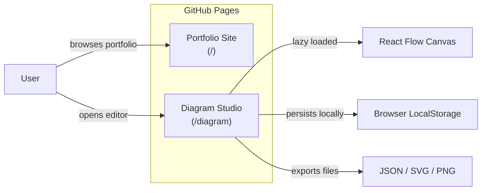
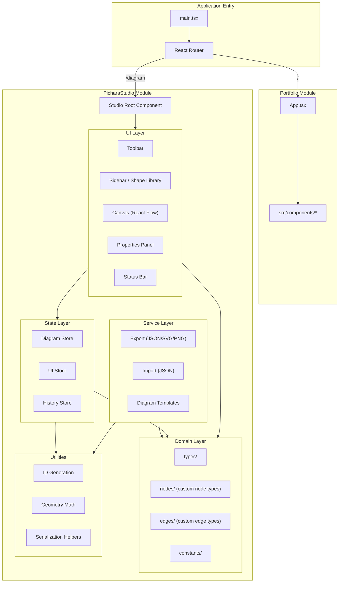
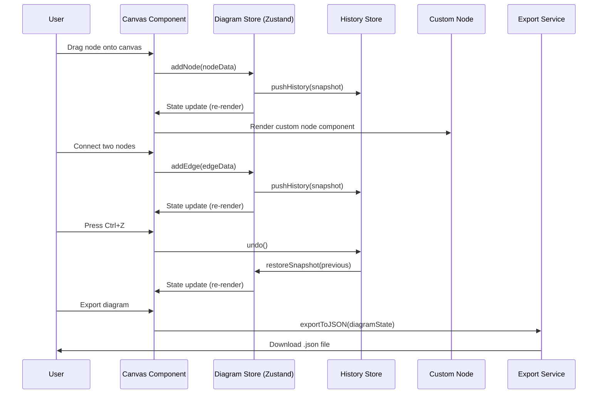
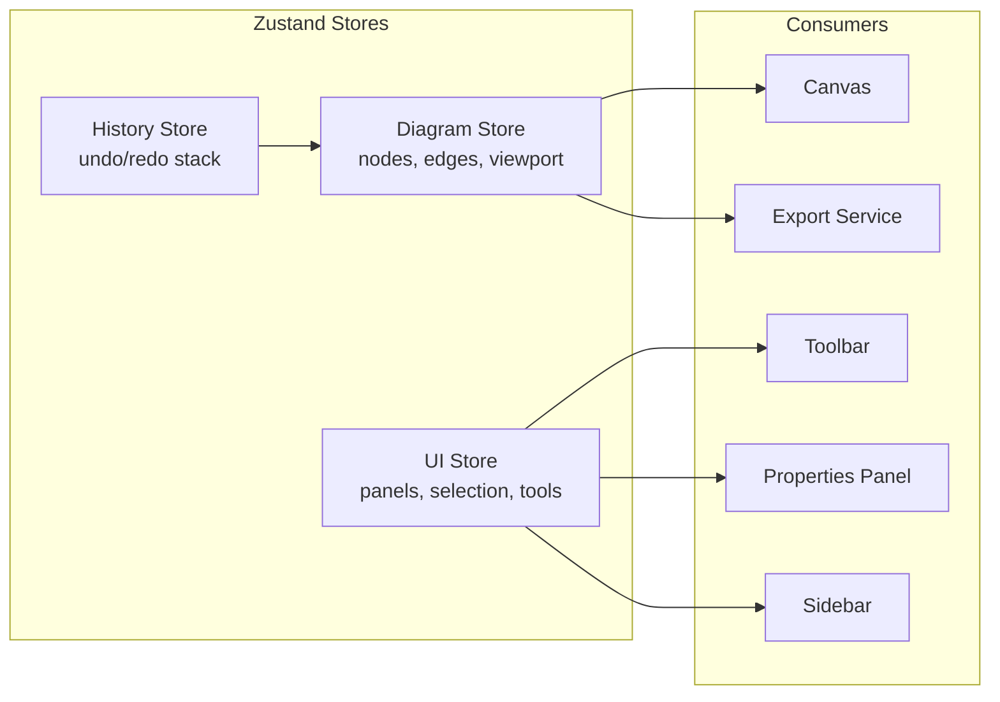

# Architecture Overview — Pichara Diagram Studio

## System Context

Pichara Diagram Studio is a client-side diagram editor embedded within the Pichara.io portfolio website. It shares the same Vite build, the same deployment pipeline, and the same GitHub Pages hosting — but operates as an independent feature module with its own component tree, state management, and routing path.

## Application Boundaries

### Portfolio (existing)

- **Path:** `/`
- **Components:** `src/components/` — Hero, About, Experience, Projects, Contact
- **Data:** `src/data.ts` — static profile, timeline, and project data
- **Styling:** `src/index.css` — dark-green Matrix-inspired theme
- **Animation:** `src/effects/` — Matrix digital rain engine

### Diagram Studio (new)

- **Path:** `/diagram`
- **Module root:** `src/PicharaStudio/`
- **Rendering:** React Flow (`@xyflow/react`) infinite canvas
- **State:** Zustand stores for diagram data, editor UI, and history
- **Persistence:** LocalStorage + file export/import — no backend

The two boundaries communicate only through the router. The portfolio does not import diagram editor code, and the diagram editor does not import portfolio components.

## Module Architecture

## Data Flow

## Diagram Rendering

React Flow (`@xyflow/react`) is the rendering engine. It provides:

- **Infinite canvas** with pan and zoom
- **Node rendering** via custom React components
- **Edge rendering** with configurable path types (bezier, step, smoothstep, straight)
- **Built-in interactions:** drag, select, multi-select, connect, resize
- **Minimap, controls, and background** components

Pichara Diagram Studio extends React Flow by:

1. **Registering custom node types** — Each diagram category (flowchart, UML, ERD, etc.) defines its own node components in `nodes/`.
2. **Registering custom edge types** — Specialized edge renderers for different diagram styles.
3. **Managing state externally** — React Flow's internal state is synchronized with Zustand stores so that undo/redo, serialization, and persistence work correctly.

## State Management Strategy

**Diagram Store:** The source of truth for all diagram data — nodes, edges, viewport position, and diagram metadata. This store's state must be fully JSON-serializable at all times.

**UI Store:** Transient editor state — which panel is open, current tool mode, selection state, zoom level display. Not persisted.

**History Store:** Maintains an undo/redo stack of diagram snapshots. Operates on the Diagram Store's state.

## Routing Strategy

The application will use `react-router-dom` with `HashRouter` for GitHub Pages compatibility:

| Path | Component | Description |
|---|---|---|
| `/` | `App` (portfolio) | Existing portfolio site |
| `/diagram` | `DiagramStudio` (lazy loaded) | Diagram editor application |

`HashRouter` is chosen over `BrowserRouter` because GitHub Pages does not support server-side URL rewriting. With `HashRouter`, the URL becomes `https://pichara.github.io/#/diagram`, which works without any server configuration.

## Technology Rationale

See [ADR-001: Diagram Rendering Engine](../decisions/001-diagram-rendering-engine.md) for the React Flow selection rationale.

**Why Zustand over Redux / Context / Jotai:**
- Minimal boilerplate — no providers, reducers, or action creators.
- Works outside React — services and utilities can read/write state.
- Fine-grained subscriptions — components re-render only when their selected slice changes.
- Small bundle (~1 KB gzipped).
- Immer middleware available for complex immutable updates.

**Why HashRouter over BrowserRouter:**
- GitHub Pages serves a single `index.html` and does not support URL rewriting.
- `BrowserRouter` would require a `404.html` hack that is fragile.
- `HashRouter` works out of the box with no server configuration.
- The trade-off (hash in URL) is acceptable for a tool application.
